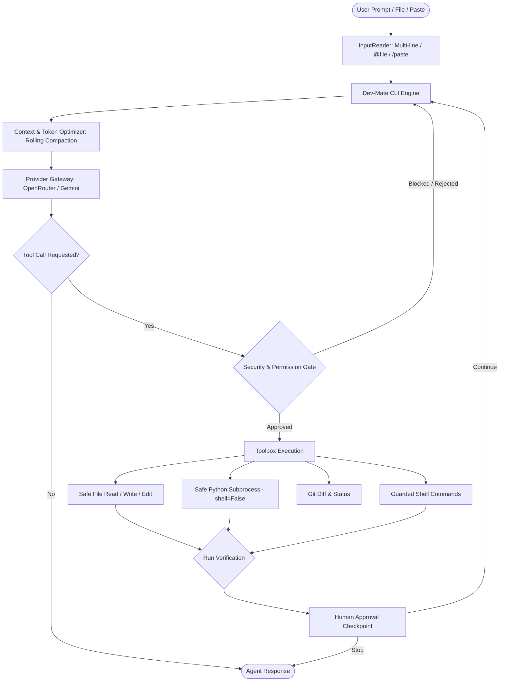

# ⚡ Dev-Mate

<p align="center">
  
  
  
  
  
  
  
  
</p>

A lightweight, security-first, multi-provider **AI Software Engineering Agent** designed to operate directly on real local repositories with zero speculative chaos, intelligent token optimization, dual-model multi-agent delegation (Google Gemini & OpenRouter side-by-side), and full human-in-the-loop control.

---

## 🚀 Key Capabilities

- **Document & Report Quality Linter (Day 3)**:
  - 🎨 **Unified Design Tokens & Color Palettes**: Institutional themes (Academic Navy `#0B192C`, Emerald Tech, Crimson Executive, Slate Minimal) with WCAG AA & AAA contrast validation.
  - 📊 **Table & Cell Validator**: Detects and automatically repairs mismatched column spans, blank/phantom rows, missing header separators, and unaligned cells in Markdown and HTML.
  - 🔍 **Document Quality Scoring Engine (`lint_document`)**: Grades files (0–100 quality score) and flags typography hierarchy skips (e.g. H1 &rarr; H3 jumps), placeholder leaks (`[TODO]`, `[TBD]`, `Lorem ipsum`), and broken link/media targets.
  - 🛠️ **CLI Integration (`/lint <path> [--fix]`)**: On-demand document linting and automated auto-fix with timestamped backups.
- **Multi-Agent Swarm & Side-by-Side Dual-Model Delegation**:
  - 🤝 **Dual-Model Collaboration (`/team <goal>`)**: Runs Google Gemini and OpenRouter side-by-side in a 3-phase deliberation pipeline (Lead drafts proposal &rarr; Peer stress-tests & critiques &rarr; Lead synthesizes finalized consensus plan).
  - 🧐 **Cross-Model Peer Review (`/review [file/diff]`)**: Automatically delegates an adversarial code and security review of any file or git diff to the alternate model.
  - 🤖 **Autonomous Tool-Based Delegation (`delegate_task`)**: Dev-Mate can spin off specialized lightweight subagents during any engineering task.
  - 🎭 **Role Specialization**: Subagents are isolated to least-privilege toolsets based on their role:
    - `researcher`: Read-only codebase explorer (`read_file`, `search_files`, `list_files`, `view_outline`, `get_definition`, `project_summary`).
    - `reviewer`: Independent critic evaluating logic flaws, edge cases, security, and diffs (`read_file`, `search_files`, `git_diff`).
    - `debugger`: Diagnostic specialist isolating root causes from test failures (`read_file`, `search_files`, `run_python`, `run_command`).
    - `general`: Autonomous executor.

- **Antigravity-Style API Token Optimization**:
  - 📉 **Rolling Tool Compaction**: Replaces bulky tool results from earlier turns with dense 1-line checkpoints, saving 70–85% of tokens.
  - 🧠 **Dynamic Context Window Budgeting**: Automatically compacts conversation history before exceeding token quotas (`MAX_CONTEXT_TOKENS`).
  - 📦 **Lean System Overview**: High-level tree and extension stats replace raw file lists in the system prompt.
  - ✂️ **Intelligent Output Truncation**: Bounded file reading, top search hits, and head/tail command output compression.
- **Advanced CLI Input Window**:
  - 📋 **Bracketed Paste**: Paste massive paragraphs, stack traces, and multi-page code blocks without line-by-line triggers.
  - 📄 **File Ingestion (`/file <path>`)**: Feed entire files directly into your prompt.
  - 🔗 **Inline File Expansion (`@filepath`)**: Mention `@path/to/file` anywhere in your prompt to automatically inline its content.
  - 📝 **Dedicated Paste Buffer (`/paste`)**: Paste arbitrary text blocks and submit with `:end` or `EOF`.
  - 🖋️ **External Editor (`/editor`)**: Compose complex prompts in your system editor (Notepad/nano).
- **Dual Provider Gateway**: Seamlessly switch between OpenRouter and Google Gemini (`generateContent` with structured function-calling).
- **Security-First Execution Sandbox**:
  - 🛡️ Strict project path isolation (blocks path traversal, Windows special device names).
  - 🔒 Secret exfiltration protection (blocks reading or writing `.env`, `.git/`, and credentials).
  - ⚡ Shell-safe Python execution (`shell=False` under `sys.executable` eliminates command injection).
  - 🪟 Windows UTF-8 encoding safety (prevents `UnicodeDecodeError` in subprocesses).
- **Systematic Engineering Loop**: Inspect &rarr; Plan &rarr; Edit &rarr; Execute &rarr; Diagnose &rarr; Verify &rarr; Checkpoint.
- **Antigravity-Style Interactive Permission Modals (Day 2)**:
  - 🛡️ **Interactive Permission Cards (`prompt_permission`)**: Rich modal cards displaying action, target, details, and risk tier badges (`🟢 LOW RISK`, `🟡 MEDIUM RISK`, `🔴 HIGH RISK`).
  - 🎛️ **Action Options**: Single-key or menu selection for `[1] Proceed with change`, `[2] Inspect full diff / details`, `[3] Abort / Skip`, and `[4] Provide feedback / custom instructions`.
  - 🔍 **Integrated Diff Inspection**: Expand and inspect colorized unified diff previews before granting mutation permission.
  - 🧭 **Human-in-the-Loop Steering**: Pass custom feedback or instructions directly at engineering checkpoints to dynamically steer subsequent iterations.
- **Human-in-the-Loop Guardrails**: Dangerous commands, deletions, and checkpoints pause for explicit approval.
- **Automatic Backups**: Pre-edit and pre-deletion snapshots automatically stored in `.devmate/backups/`.
- **Persistent Project Memory**: Structured memory store (`memory.json`) and audit activity tracking (`activity.jsonl`).

---

## 🛠️ Architecture Workflow



---

## 📦 Quick Start

### Windows PowerShell

```powershell
# 1. Clone or enter project
cd H:\Devmate

# 2. Activate virtual environment
.\.venv\Scripts\Activate.ps1

# 3. Install dependencies
pip install -r requirements.txt

# 4. Configure environment
Copy-Item .env.example .env
notepad .env

# 5. Launch Dev-Mate
python -m devmate
```

Or install in editable mode for the global `devmate` launcher:

```powershell
pip install -e .
devmate
```

---

## 🔑 Environment Configuration

Create a `.env` file in the project root:

```env
# AI Providers (set either or both)
OPENROUTER_API_KEY=sk-or-v1-...
OPENROUTER_MODEL=openrouter/free

GOOGLE_API_KEY=AIzaSy...
GOOGLE_MODEL=gemini-2.5-flash

# Default settings
DEV_MATE_PROVIDER=openrouter
DEV_MATE_MODE=ask

# Loop & Safety Controls
MAX_AGENT_TURNS=30
MAX_ENGINEERING_ITERATIONS=10
COMMAND_TIMEOUT=120
AUTO_APPROVE_CHECKPOINTS=false
ALLOW_DELETE=false
ALLOW_COMMANDS=false
ALLOW_GIT_PUSH=false

# Antigravity-Style Token & API Optimizations
MAX_CONTEXT_TOKENS=16000
COMPACT_CONTEXT=true
MAX_FILE_READ_LINES=150
MAX_SEARCH_RESULTS=25
```

---

## 🎯 Operating Modes

| Mode | Behavior | Safety Stance |
| :--- | :--- | :--- |
| `ask` | Answers architectural questions, inspects files, runs checks on approval | All mutations require confirmation |
| `edit` | Applies requested code edits and changes directly | Dangerous commands require confirmation |
| `engineer` | Iterates step-by-step toward a high-level goal | Pauses at every iteration checkpoint |
| `autonomous` | Iterates through multiple improvements toward a goal | Pauses at checkpoints unless auto-approved |

---

## 💬 Interactive Commands

Inside the interactive `devmate ❯` prompt:

| Command | Action |
| :--- | :--- |
| `/team <goal>` | Run collaborative multi-agent deliberation between Google Gemini & OpenRouter |
| `/review [path]` | Delegate an independent cross-model peer review of a file or git diff |
| `/file <path> [prompt]` | Read an entire text file from disk directly as your prompt |
| `@filepath` (inline) | Reference any file inline to inject its contents into the prompt |
| `/paste` | Enter multi-line paste mode (paste massive text, type `:end` to submit) |
| `/editor` | Open external editor (Notepad/nano) to write or paste large prompts |
| `/tokens` | Display session token usage, API calls, and compaction savings |
| `/lint <path> [--fix]` | Lint document/report for tables, styles, & placeholders (with auto-fix) |
| `/provider <name>` | Switch model provider (`openrouter` \| `google`) |
| `/mode <name>` | Switch active mode (`ask` \| `edit` \| `engineer` \| `autonomous`) |
| `/status` | View git working tree status |
| `/diff` | View syntax-highlighted git diff |
| `/memory` | Inspect structured project memory and saved decisions |
| `/history` | View recent activity audit log |
| `/help` | Display interactive command reference |
| `/exit` | End current session |

---

## 🧪 Testing & Verification

Run the comprehensive test suite:

```powershell
pytest -v
```

All 92 test cases verify:
- Document & Report Quality Linter & table auto-repair (`devmate/design.py`, `lint_document`)
- Color token contrast calculation & WCAG AA / AAA compliance
- Institutional color themes (`Academic Navy`, `Emerald Tech`, `Crimson Executive`, `Slate Minimal`)
- Typography scale hierarchy validation & heading skip detection
- Markdown & HTML table parsing, column balance, blank row detection, and auto-alignment
- Unresolved placeholder and hallucination leak detection (`[TODO]`, `[TBD]`, `Lorem ipsum`)
- Interactive permission & approval modal protocol (`prompt_permission`, `render_permission_card`)
- Risk tier classification (`🟢 LOW`, `🟡 MEDIUM`, `🔴 HIGH`)
- Single-key approval, abort, and diff inspection workflows
- Interactive feedback and human-in-the-loop iteration steering
- Interactive clarification protocol & anti-hallucination guardrails (`ask_clarification`)
- Grounding and project identity preservation
- Multi-agent swarm orchestration & dual-provider deliberation (Gemini + OpenRouter)
- Subagent role isolation (researcher, reviewer, debugger, general)
- Cross-model peer provider auto-selection
- Path traversal rejection (`../`, `../../etc/passwd`)
- Windows reserved device names rejection (`CON`, `PRN`, `AUX`, `NUL`)
- Secret protection (`.env`, `.env.*`, `.git/hooks`)
- Shell injection elimination in `run_python`
- Dynamic token estimation, rolling compaction, and token tracking
- Multi-line bracketed paste, file ingestion, and inline `@file` expansion
- Graceful Ctrl+C keyboard interrupt handling (no crash / stack trace)
- Encoding safety and timeout limits in `run_command`
- Structured memory persistence and activity log bounds

---

## 📄 License

MIT License &copy; 2026 Dev-Mate. Built with care for software engineers.
