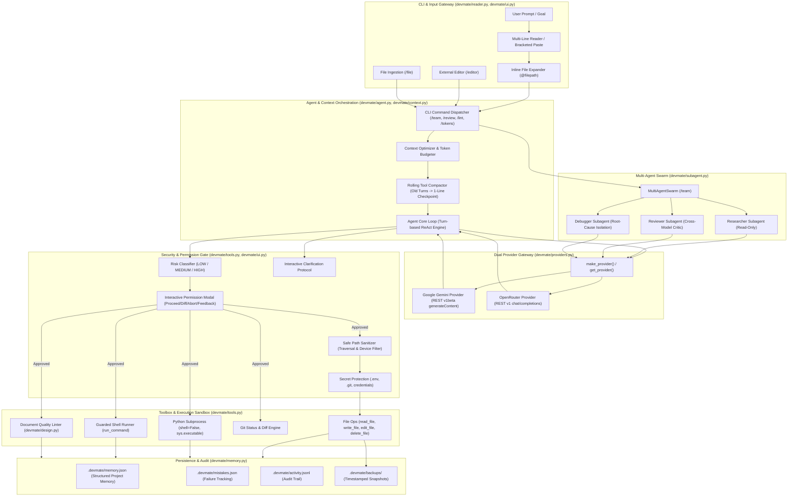
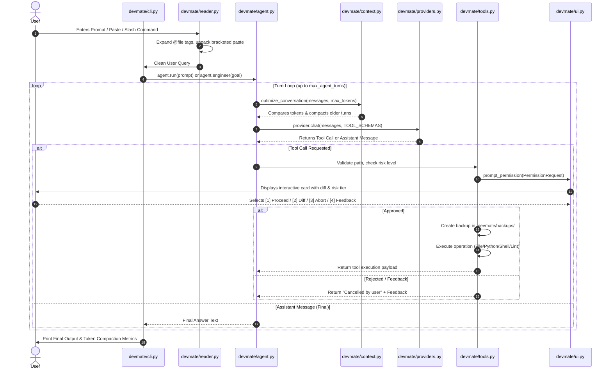

# Dev-Mate: System Architecture & Technical Specification

> **Version**: 0.1.0  
> **Target Platform**: Windows, Linux, macOS (Python 3.11+)  
> **Core Architecture**: Lightweight, Multi-Provider, Security-First AI Software Engineering Agent  

---

## 1. Executive Summary & Philosophy

**Dev-Mate** is an autonomous and interactive AI Software Engineering Agent engineered specifically for direct operation on local, real-world source code repositories. Unlike traditional LLM wrappers or speculative coding assistants, Dev-Mate adheres to a strict set of architectural tenets:

1. **Zero Speculative Chaos**: Dev-Mate never assumes file structures, imports, or variable names. It operates under a systematic loop: *Inspect &rarr; Plan &rarr; Edit &rarr; Verify &rarr; Diagnose &rarr; Checkpoint*.
2. **Deterministic Grounding & Anti-Hallucination**: The agent is strictly prohibited from fabricating empirical metrics, numbers, survey results, or changing project names/identities without explicit human clarification via interactive modals.
3. **Multi-Provider Side-by-Side Swarm**: Simultaneous support for Google Gemini (direct REST API with native function calling) and OpenRouter (OpenAI-compatible chat completions) operating concurrently in a 3-phase deliberation pipeline (*Propose &rarr; Peer Review &rarr; Synthesize*).
4. **Antigravity-Style Token & API Optimization**: Implements rolling tool compaction, dynamic context window budgeting, head/tail text compression, and lean project summaries—yielding **70% to 85% token savings** on long development sessions.
5. **Least-Privilege Security Sandbox**: Complete immunity against path traversal, Windows reserved device attacks, secret exfiltration (`.env`, `.git`), and command injection (eliminating shell execution in `run_python` via `shell=False` under `sys.executable`).
6. **Human-in-the-Loop Guardrails**: Interactive modal permission cards with automatic risk tiering (`🟢 LOW`, `🟡 MEDIUM`, `🔴 HIGH`), live colored diff previews, and mid-loop steering feedback.

---

## 2. System Architecture Diagram



---

## 3. High-Level Execution Lifecycle

The lifecycle of an interaction in Dev-Mate follows an event-driven, bounded execution pipeline:



---

## 4. Module-by-Module Technical Breakdown

### 4.1 Configuration Layer (`devmate/config.py`)
Encapsulates runtime settings loaded dynamically from `.env` and environment variables.

- **`Config` Data Class**:
  - `root: Path`: Absolute project workspace root directory.
  - `provider: str`: Active LLM provider (`"openrouter"` or `"google"`).
  - `mode: str`: Operating mode (`"ask"`, `"edit"`, `"engineer"`, `"autonomous"`).
  - `openrouter_key`, `openrouter_model`: OpenRouter API credentials.
  - `google_key`, `google_model`: Google Gemini credentials.
  - `max_context_tokens: int`: Threshold for triggering rolling compaction (default: `16,000`).
  - `max_file_read_lines: int`: Maximum lines read in a single file slice (default: `150`).
  - `max_search_results: int`: Bounded search matches to prevent prompt overflow (default: `25`).
  - `allow_delete`, `allow_commands`, `allow_git_push`: Security flags.

### 4.2 Multi-Provider Gateway (`devmate/providers.py`)
Implements uniform interface adapters across disparate AI API protocols:

- **`OpenRouterProvider`**:
  - Targets `https://openrouter.ai/api/v1/chat/completions`.
  - Supports standard OpenAI function-calling schema (`tool_calls` with JSON string arguments).
  - Handles HTTP status codes, timeout configurations, and connection recovery.
- **`GoogleProvider`**:
  - Direct REST implementation targeting Google Gemini `v1beta/models/{model}:generateContent`.
  - **Schema Translation**: Translates OpenAI function schemas into Gemini `functionDeclarations`.
  - **Message Structure Normalization**:
    - Converts `role: "system"` into Gemini's top-level `systemInstruction`.
    - Maps `role: "user"` into `parts: [{"text": ...}]`.
    - Maps `role: "assistant"` with `tool_calls` into `functionCall: {"name": ..., "args": ...}`.
    - Maps `role: "tool"` outputs into Gemini `functionResponse: {"name": ..., "response": {"result": ...}}`.
  - Bypasses external SDK lock-in for zero latency and low package weight.

### 4.3 Multi-Agent Swarm & Delegation (`devmate/subagent.py`)
Orchestrates parallel and sequential multi-agent workflows:

- **`SubAgent`**:
  - Isolated agent instance initialized with a specific role and constrained tool set.
  - **Role Specialization**:
    - `researcher`: Read-only file inspection (`list_files`, `read_file`, `search_files`, `project_summary`, `git_status`, `git_diff`). Strictly blocked from write operations.
    - `reviewer`: Adversarial critic for code quality, logic errors, and security audits.
    - `debugger`: Targeted log and stack trace diagnostic agent.
    - `general`: Autonomous agent capable of file mutation under supervision.
- **`MultiAgentSwarm`**:
  - **Dual-Model Deliberation (`/team <goal>`)**: Runs Google Gemini and OpenRouter concurrently:
    1. *Phase 1*: Lead provider drafts concrete technical proposal.
    2. *Phase 2*: Alternate provider acts as adversarial reviewer, critiquing assumptions and edge cases.
    3. *Phase 3*: Lead provider synthesizes review critiques into a hardened consensus plan.
  - **Cross-Model Peer Review (`/review [file/diff]`)**: Automatically assigns code review to the opposite model provider.

### 4.4 Security Sandbox & Guardrails (`devmate/tools.py`)
Enforces least-privilege constraints across every workspace mutation:

- **`safe_path(root, rel)`**:
  - Resolves path strictly relative to the project root.
  - **Path Traversal Defense**: Throws `ValueError` if path contains `..` or escapes the root boundary.
  - **Windows Reserved Device Defense**: Rejects `CON`, `PRN`, `AUX`, `NUL`, `COM1-9`, `LPT1-9`.
  - **Secret Exfiltration Filter**: Throws `PermissionError` on `.env`, `.env.*`, `.git/`, `.bash_history`, `id_rsa`, `id_ed25519`.
- **Command Injection Elimination**:
  - `run_python` uses `subprocess.run([sys.executable, str(target_path)], shell=False)`. Shell interpolation is completely bypassed.
- **Destructive Command Pattern Detection**:
  - Regex filtering for `rm -rf`, `format`, `mkfs`, `dd if=`, `drop database`, `git reset --hard`, `git clean -fdx`.

### 4.5 Interactive UI & Risk Protocol (`devmate/ui.py`)
Delivers terminal visual hierarchy and Antigravity-style human-in-the-loop interactions:

- **Permission Cards (`prompt_permission`)**:
  - Displays action, target, risk classification badge (`🟢 LOW`, `🟡 MEDIUM`, `🔴 HIGH`), details, and 6-line preview diff.
  - **Available Options**:
    - `[1] Proceed with change` (Default / Enter)
    - `[2] Inspect full diff / details` (Opens colorized full diff view without exiting)
    - `[3] Abort / Skip` (Cancels action)
    - `[4] Provide feedback / custom instructions` (Injects steering instructions back into the engineering loop)
- **Interactive Clarification Modal (`prompt_clarification`)**:
  - Invoked via `ask_clarification` tool when specifications or empirical data are ambiguous.
  - Allows selecting from numbered options or entering arbitrary custom guidance.

### 4.6 Antigravity Context Window & Token Optimization (`devmate/context.py`)
Prevents token inflation and context window exhaustion:

- **Token Estimator (`estimate_tokens`, `estimate_messages_tokens`)**:
  - Fast, heuristic token estimator averaging ~3.6 characters per token across mixed text, code, and JSON.
- **Rolling Tool Compaction (`compact_tool_output`, `optimize_conversation`)**:
  - When conversation approaches `max_context_tokens`, older tool execution payloads (turns prior to the most recent 2 turns) are compacted into high-density 1-line checkpoints.
  - Example: A 200-line `read_file` payload is replaced with:  
    `[File content (200 lines) previously read and processed in turn 3: def calculate_metrics()...]`
  - Saves **70%–85% of token budget** across long sessions.
- **Head/Tail Output Compression (`compress_text`)**:
  - Preserves initial 15 lines (context) and trailing 25 lines (results/stack traces), compressing thousands of middle lines into an informative omission banner.

### 4.7 Input Window & Shell Ergonomics (`devmate/reader.py`, `devmate/cli.py`)
Enhances developer input handling in terminal environments:

- **Bracketed Paste Support**: Integrates `prompt_toolkit` to seamlessly receive multi-line code blocks and stack traces without line-by-line triggers.
- **Inline Context Expansion (`@filepath`)**: Writing `@devmate/agent.py` automatically inlines the file's contents into the prompt payload.
- **Dedicated Modes**:
  - `/file <path>`: Ingests an entire file from disk.
  - `/paste`: Dedicated paste buffer submitted via `:end` or `EOF`.
  - `/editor`: Spawns the system text editor (Notepad on Windows, nano on Unix) for complex prompt composition.

### 4.8 Document & Report Quality Linter (`devmate/design.py`)
Automated quality assurance and formatting engine for Markdown, HTML, and project reports:

- **Color Palettes & WCAG Contrast**:
  - Built-in institutional themes: `Academic Navy` (`#0B192C`), `Emerald Tech`, `Crimson Executive`, `Slate Minimal`.
  - Full W3C WCAG 2.1 relative luminance and contrast ratio validation (`>= 4.5:1` for AA, `>= 7.0:1` for AAA).
- **Table Integrity & Auto-Repair (`TableLinter`)**:
  - Parses Markdown and HTML tables, detecting mismatched column counts, phantom blank rows, and missing header separators.
  - `auto_fix_content`: Reconstructs and aligns unbalanced tables automatically.
- **Document Quality Scoring (`DocumentLinter`)**:
  - Generates a 0–100 quality score, flagging heading skips (e.g. H1 &rarr; H3), placeholder leaks (`[TODO]`, `[TBD]`, `Lorem ipsum`), and unaligned cells.

### 4.9 Project Memory & Audit Logging (`devmate/memory.py`)
Maintains session state and auditability across restarts:

- `.devmate/memory.json`: Structured persistent memory containing key architectural decisions, important files, preferences, and prompt improvements.
- `.devmate/mistakes.json`: Systematic failure logging tracking error types, descriptions, and verified corrections.
- `.devmate/activity.jsonl`: Append-only chronological audit log of all tool executions, arguments, and return statuses.
- `.devmate/backups/`: Timestamped pre-modification snapshots created prior to any file edit, write, or deletion.
- `.devmate/audit/`: Formatted markdown compliance logs generated by `export_audit_log()` and `/audit`.

### 4.10 Code Intelligence & AST Analysis (`devmate/tools.py`)
Dev-Mate incorporates Python Abstract Syntax Tree (AST) static analysis without code execution:

- **Structural Outlines (`view_outline`)**: Generates class and function hierarchies with docstrings and line signatures in <150 tokens.
- **Symbol Definitions (`get_definition`)**: Extracts exact source code, parameters, docstrings, and line bounds for any class or function across the repository.
- **Reference Resolution (`find_references`)**: Locates every AST occurrence, call site, and attribute access of a symbol with enclosing scope context (`class Calculator -> def add`) and code snippets.
- **Dependency & Cycle Detection (`analyze_dependencies`)**: Static import analysis separating standard library modules, external third-party libraries, and internal project dependencies. Employs cycle detection to highlight circular imports before deployment.
- **Zero-Execution Syntax Validation (`check_syntax`)**: Catches `SyntaxError`, `JSONDecodeError`, and `TOMLDecodeError` with line, column, and a 3-line visual code window before running or committing.

### 4.11 Verification & Self-Healing Testing Engine (`devmate/tools.py`, `devmate/agent.py`)
Autonomous verification loop enabling the agent to test and self-heal:

- **Isolated Test Runner (`run_tests`)**: Spawns `pytest` (or fallback `unittest`) in a safe isolated subprocess, parsing pass/fail/error counts and extracting failure traces for fast agent reasoning.
- **Smart Diagnostic Feedback**: When a tool throws an error (e.g. `FileNotFoundError`, `ValueError` in `edit_file`, or `SyntaxError`), the agent automatically receives recovery hints suggesting `list_files`, indentation verification via `read_file`, or deterministic `replace_lines`.
- **Atomic Undo & Rollback**: Microsecond-indexed snapshots in `.devmate/backups/` and manifest tracking allow immediate reversal via `rollback_file` and `undo_last_change`.

### 4.12 Interactive Setup Wizard (`devmate/wizard.py`)
Frictionless first-time user onboarding:
- Configures Google Gemini, OpenRouter, or 100% free offline Ollama in under 30 seconds.
- Performs live API connectivity verification before writing settings into `.env`.
- Invoked via `devmate --init`, slash command `/init`, or automatically when running without configured keys.

### 4.13 Zero-Dependency Local Web Dashboard (`devmate/web.py`)
Built-in local browser interface running on Python's native `http.server`:
- Serves the luxury dark control dashboard at `http://127.0.0.1:8080`.
- Provides full REST API endpoints (`/api/doctor`, `/api/tests`, `/api/diff`, `/api/status`, `/api/deps`, `/api/chat`).
- Launchable from the CLI via `devmate --web [port]` or the interactive `/web` slash command.

---

## 5. Directory Layout & Architecture Organization

Following our directory improvements, the codebase maintains a clean separation of concerns:

```
devmate/
├── .devmate/                       # Persistent agent state & local audit
│   ├── backups/                    # Timestamped pre-edit file backups
│   ├── activity.jsonl              # Chronological activity audit trail
│   ├── memory.json                 # Structured project memory
│   └── mistakes.json               # Recorded failure modes & fixes
├── devmate/                        # Core Python Package (Only pure agent logic)
│   ├── __init__.py                 # Public package exports & version
│   ├── __main__.py                 # Package executable entrypoint
│   ├── agent.py                    # ReAct agent loop & engineering iterations
│   ├── cli.py                      # Interactive terminal REPL & command handlers
│   ├── config.py                   # Centralized configuration & environment loader
│   ├── context.py                  # Token tracker & rolling context compactor
│   ├── design.py                   # Document quality linter & WCAG color engine
│   ├── memory.py                   # Structured memory & activity logger
│   ├── providers.py                # Google Gemini & OpenRouter adapters
│   ├── reader.py                   # Input reader with autocomplete, history & @file
│   ├── subagent.py                 # MultiAgentSwarm & role-isolated subagents
│   ├── tools.py                    # Security-guarded tool implementation
│   ├── ui.py                       # Modern terminal UI & permission modal cards
│   ├── web.py                      # Built-in local web dashboard & REST API server
│   └── wizard.py                   # Interactive provider setup wizard (30s onboarding)
├── docs/                           # Architecture, Specifications & Guides
│   ├── ARCHITECTURE.md             # This comprehensive architecture document
│   └── data_structures_guide.md    # Reference guide for core project data structures
├── examples/                       # Web & Visualization Demonstrations
│   ├── contact.html                # Dark luxury contact interface demo
│   ├── dashboard.html              # Live luxury control dashboard & web GUI
│   ├── portfolio.html              # Interactive dark luxury portfolio demo
│   └── tree-ds.html                # Tree data structure visualizer
├── scripts/                        # Utility & Generation Scripts
│   ├── generate_ds_pdf.py          # Data structures PDF generator
│   └── generate_simple_pdf.py      # Simple PDF builder script
├── tests/                          # Automated Pytest Suite (140 Unit Tests)
│   ├── test_agent.py               # ReAct loop, tool dispatch & autonomous iteration tests
│   ├── test_clarification.py       # Clarification modal & anti-hallucination tests
│   ├── test_cli.py                 # Slash commands, one-shot prompt, fuzzy match & flags
│   ├── test_config.py              # Configuration & provider factory tests
│   ├── test_context.py             # Token compaction & text compression tests
│   ├── test_design.py              # WCAG contrast, typography & table linter tests
│   ├── test_memory.py              # Memory persistence & activity log tests
│   ├── test_permission.py          # Interactive permission modals & risk tiers
│   ├── test_reader.py              # Autocompleter, @file expansion & file ingestion tests
│   ├── test_resilience.py          # HTTP 429/5xx retry backoff & custom endpoint tests
│   ├── test_security.py            # Path traversal, secret leak & device name tests
│   ├── test_subagent.py            # Swarm collaboration & subagent role isolation
│   ├── test_tools.py               # AST outline, definition, refs, deps, syntax & test runner
│   ├── test_web.py                 # Built-in web dashboard HTTP & REST API tests
│   └── test_wizard.py              # Interactive setup wizard & key verification tests
├── .env.example                    # Environment template with safety controls
├── .gitignore                      # Hardened git ignore rules
├── pyproject.toml                  # PEP 621 packaging metadata
├── README.md                       # User-facing manual & quick start
└── requirements.txt                # Pinned production dependencies
```

---

## 6. Security & Permission Matrix

| Operation | Risk Level | Safety Checks Enforced | Confirmation Required? |
| :--- | :--- | :--- | :--- |
| `read_file` | `🟢 LOW` | Escaping root blocked, `.env`/`.git` blocked, binary guard, line cap (200) | No (Safe) |
| `search_files` | `🟢 LOW` | Protected dirs omitted, text-only extension filter, hit cap | No (Safe) |
| `list_files` | `🟢 LOW` | Protected dirs omitted, 100-file pagination limit | No (Safe) |
| `view_outline` | `🟢 LOW` | AST-based syntax analysis, read-only extraction of classes & functions | No (Safe) |
| `get_definition` | `🟢 LOW` | AST symbol resolution, line range extraction, read-only | No (Safe) |
| `find_references` | `🟢 LOW` | AST reference finder across project python files, scope tracking | No (Safe) |
| `check_syntax` | `🟢 LOW` | Zero-execution syntax validation (Python, JSON, TOML, MD, HTML) | No (Safe) |
| `analyze_dependencies`| `🟢 LOW` | Static import analysis, stdlib vs 3rd-party, cycle detection | No (Safe) |
| `grep_search` | `🟢 LOW` | Bounded regex pattern matching with line-number context | No (Safe) |
| `run_doctor` | `🟢 LOW` | Diagnostic read of Python, Git, Provider keys, and storage | No (Safe) |
| `export_audit_log` | `🟢 LOW` | Formatted markdown compliance report generation | No (Safe) |
| `plan_task` | `🟢 LOW` | Subagent non-destructive architectural planning | No (Safe) |
| `write_file` | `🟡 MEDIUM` | Automatic pre-write backup to `.devmate/backups/`, secret block | In `ask` mode |
| `edit_file` | `🟡 MEDIUM` | Exact match + CRLF/LF normalization, automatic pre-edit backup | In `ask` mode |
| `replace_lines` | `🟡 MEDIUM` | Boundary validation, automatic pre-edit backup | In `ask` mode |
| `rollback_file` | `🟡 MEDIUM` | Manifest-based snapshot restoration to original path | In `ask` mode |
| `undo_last_change` | `🟡 MEDIUM` | Reverts last popped snapshot from backup manifest | In `ask` mode |
| `run_tests` | `🟢 LOW` / `🟡 MEDIUM` | Isolated pytest execution, timeout guard, failure parsing | If `allow_commands=false` |
| `git_commit` | `🟡 MEDIUM` | Tracked changes staging with commit message confirmation | Requires approval |
| `delete_file` | `🔴 HIGH` | Automatic pre-deletion backup, project boundary check | **Always** (unless `allow_delete=true`) |
| `run_python` | `🟡 MEDIUM` | `shell=False`, executed via `sys.executable`, project root isolation | If `allow_commands=false` |
| `run_command` | `🟡 MEDIUM` | Project root cwd, encoding normalization, execution timeout | If `allow_commands=false` |
| `run_command` *(destructive)* | `🔴 HIGH` | Regex match for dangerous patterns (`rm -rf`, `format`, `dd`) | **Always** |
| `delegate_task` | `🟢 LOW` / `🟡 MEDIUM` | Role isolation (`researcher` is strictly read-only) | Role-dependent |
| `ask_clarification` | `🟢 LOW` | Modal pause requesting explicit user decision | Interactive |
| `lint_document` | `🟢 LOW` / `🟡 MEDIUM` | Pre-repair backup created when `auto_fix=True` | Auto-fix creates backup |

---

## 7. Testing & Verification Architecture

Dev-Mate's test suite covers 15 distinct testing domains spanning **140 tests with ~80% statement coverage**:

1. **Clarification Protocol (`test_clarification.py`)**: Tests modal card formatting, indexed selection, custom answers, and anti-hallucination system prompt rules.
2. **Configuration & Providers (`test_config.py`)**: Tests boolean environment flag parsing, provider factory dispatch, Ollama local configuration, and missing key exceptions.
3. **Context Optimization (`test_context.py`)**: Tests token estimation heuristics, head/tail text compression, and rolling compaction across all tool types.
4. **Design & Document Quality (`test_design.py`)**: Tests relative luminance, WCAG AA/AAA contrast calculations, typography scale hierarchies, table column alignment, blank row elimination, and placeholder leak detection.
5. **Memory & Audit (`test_memory.py`)**: Tests JSON memory persistence, mistake recording and deduplication, structured markdown export (`export_summary`), and activity log bounds.
6. **Permission Protocol (`test_permission.py`)**: Tests risk tier classification, modal card rendering, single-key approval (`[1]`), diff inspection (`[2]`), abort (`[3]`), and dynamic feedback injection (`[4]`).
7. **Reader & Input (`test_reader.py`)**: Tests multi-line bracketed paste, interactive tab autocomplete (`DevMateCompleter`), `@file` inline expansion, file ingestion, and prompt formatting.
8. **Security Hardening (`test_security.py`)**: Tests path traversal rejections (`../`), Windows reserved device blocking (`CON`, `NUL`), secret protection (`.env`, `id_rsa`), and script validation.
9. **Subagent & Swarm (`test_subagent.py`)**: Tests role tool isolation (`researcher` read-only constraint), peer provider automatic selection, and execution bounds.
10. **Tool Execution & Code Intelligence (`test_tools.py`)**: Tests safe reading, binary file guard, writing with backups, CRLF normalization, `replace_lines`, AST `view_outline`, AST `get_definition`, AST `find_references`, AST `analyze_dependencies`, `check_syntax`, `run_tests`, `export_audit_log`, `rollback_file`, and `undo_last_change`.
11. **Agent ReAct Loop (`test_agent.py`)**: Tests autonomous iterations, tool call execution, unknown tool fallbacks, and direct text responses.
12. **Interactive CLI & Flags (`test_cli.py`)**: Tests terminal slash command execution loop (`/help`, `/doctor`, `/test`, `/syntax`, `/refs`, `/deps`, `/audit`, `/web`, `/init`, `/clear`, `/tokens`, `/report`, `/status`, `/diff`, `/memory`, `/history`, `/outline`, `/undo`, `/exit`), `--doctor` flag, `--test` flag, `--init` flag, `--web` flag, one-shot prompt execution, and fuzzy slash command suggestion ("Did you mean...?").
13. **Network Resilience & Backoff (`test_resilience.py`)**: Tests exponential retry backoff on HTTP 429 rate limits and 5xx server errors, and custom base URL endpoints.
14. **Built-in Web Dashboard (`test_web.py`)**: Tests native HTTP server, HTML dashboard serving, and REST endpoints (`/api/doctor`, `/api/tests`, `/api/status`, `/api/diff`, `/api/deps`, `/api/chat`, `/api/syntax`, `/api/undo`).
15. **Interactive Setup Wizard (`test_wizard.py`)**: Tests key verification across Gemini and OpenRouter, local Ollama connectivity probing, `.env` file generation, and interactive onboarding flows.

To run the entire test suite:
```powershell
devmate --test
# or
pytest -v
```
To run with coverage analysis:
```powershell
pytest --cov=devmate tests/
```
